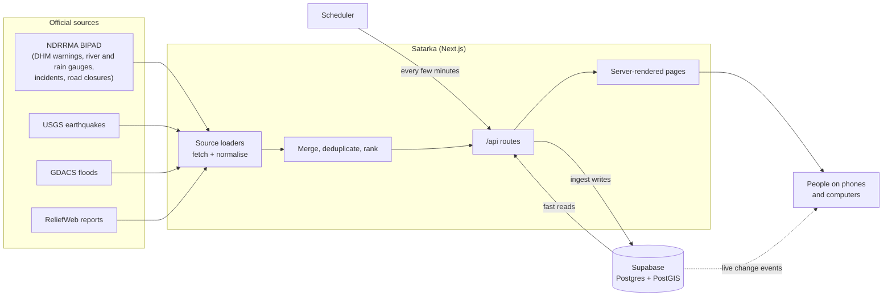

# Satarka documentation

Satarka (सतर्क, "alert") collects official hazard data for Nepal from several government and international feeds, turns it into one consistent format, and shows it in plain English and Nepali. It never replaces official warnings; it makes them easier to find and understand.

These pages explain how the system works, from the outside in.

| Page | Read it to understand |
|---|---|
| [Architecture](architecture.md) | The big picture: the parts of the system, how a page gets its data, and how the database is kept fresh |
| [Data ingestion](data-ingestion.md) | Every upstream source, how each one is fetched and normalised, and what happens when a feed is down |
| [Data model](data-model.md) | The `Alert` shape everything is converted into, the database tables, and how data expires |
| [Core concepts](concepts.md) | The ideas the whole product rests on: severity, honesty labels, deduplication, freshness |
| [Frontend](frontend.md) | Pages, data hooks, live updates, offline behaviour and the two languages |
| [Operations](operations.md) | Environment variables, the ingest schedule, database migrations and CI |

If you only have five minutes, read [Architecture](architecture.md) and then [Core concepts](concepts.md).

## The system in one picture

## Glossary

| Term | Meaning |
|---|---|
| **Alert** | One normalised hazard item, whatever source it came from. See [Data model](data-model.md#the-alert). |
| **Source** | One upstream feed plus the code that reads it (a *loader*). |
| **Source status** | How much a source can be trusted to be current: `live`, `recent`, `reference`, `report-only` or `no-feed`. |
| **Severity** | `info` < `advisory` < `watch` < `warning` < `danger`. |
| **Timeframe** | Whether an alert is happening `now`, is a `forecast`, or is an after-the-fact `report`. |
| **Provenance** | `official` (from an agency feed) or `community` (submitted by a person through the site). |
| **Ingest** | The scheduled job that fetches every source and writes the result to the database. |
| **Snapshot** | The set of alerts stored by the last ingest run. |
| **BIPAD** | Nepal's disaster information portal, run by NDRRMA. It republishes DHM hydrology data and Department of Roads closures. |
| **DHM** | Department of Hydrology and Meteorology, which runs the river and rain gauges. |
| **NDRRMA** | National Disaster Risk Reduction and Management Authority. |
| **GLOF** | Glacial lake outburst flood. |
