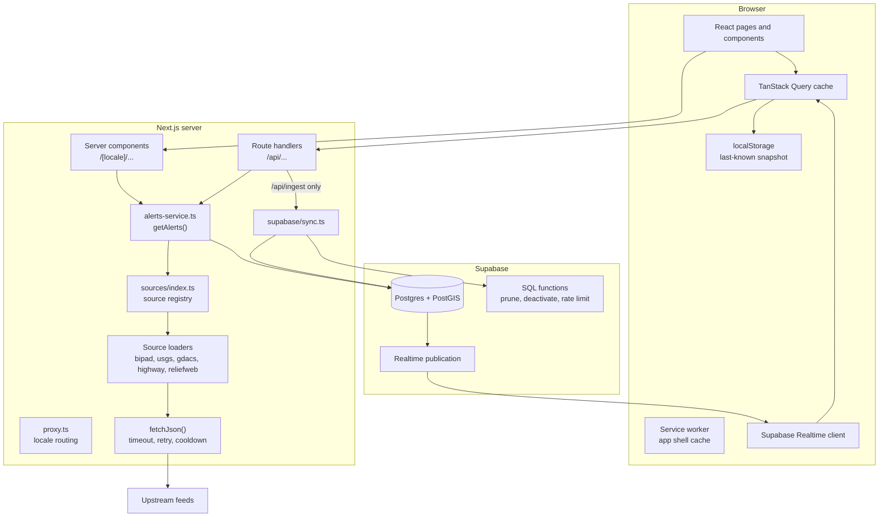
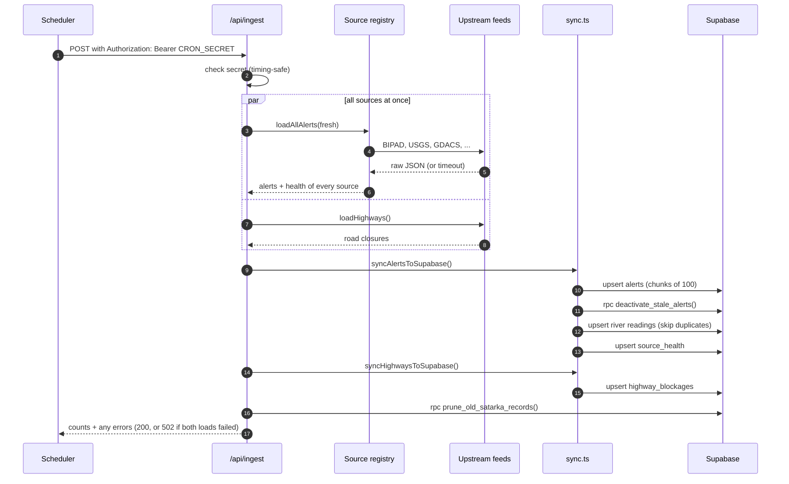
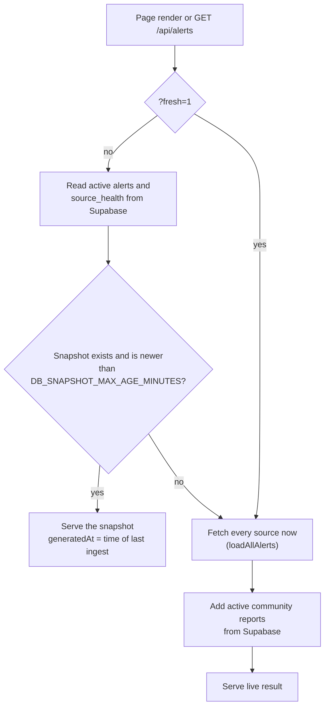

# Architecture

Satarka is a single Next.js application backed by a Supabase (Postgres + PostGIS) database. There is no separate backend service: the same codebase renders pages, serves a small JSON API, and runs the ingest job.

## Building blocks



| Part | Where | Job |
|---|---|---|
| Source loaders | `src/lib/sources/*.ts` | Fetch one upstream feed and convert it into `Alert` objects |
| Source registry | `src/lib/sources/index.ts` | Run every loader in parallel, record each one's health, merge and deduplicate |
| Fetch helper | `src/lib/sources/util.ts` | Timeouts, one retry for server errors, and a cooldown for unreachable hosts |
| Read service | `src/lib/alerts-service.ts` | The one place pages and the API get alerts from |
| Sync | `src/lib/supabase/sync.ts` | Write a fresh snapshot into the database (used only by ingest) |
| Route handlers | `src/app/api/*` | JSON endpoints for the browser and the scheduler |
| Pages | `src/app/[locale]/*` | Server-rendered pages in English (`/en`) and Nepali (`/ne`) |
| Database | `supabase/migrations/*` | Tables, indexes, security rules and SQL functions |

## Two paths: reading and ingesting

The system has one **writer** and many **readers**.

- **Ingest** (the writer) runs on a schedule. It pulls every source, merges the results and stores a snapshot in Supabase.
- **Reads** (pages and `/api/alerts`) serve that snapshot. If the snapshot is missing or too old, they fall back to fetching the sources directly, so the site keeps working even if ingest stops.

No user request ever writes alert data to the database. The only user-facing write is a community report.

### Ingest path



Each step is isolated: a failing source, a failing sync or a failing prune is recorded in the response's `errors` list but does not stop the other steps.

### Read path



Both branches return the same `AlertsResponse` shape, so the browser never needs to know which one answered. The `X-Data-Source` response header says `supabase` or `upstream-isr` for debugging.

`generatedAt` always tells the truth about age: on the database path it is the time of the last ingest run, not the time of the request.

## Caching layers

From closest to the person to furthest away:

| Layer | Where | Lifetime | Purpose |
|---|---|---|---|
| TanStack Query | Browser memory | 60 s fresh, polled every 2 min (10 min in low-data mode) | Avoid refetching on every render |
| localStorage | Browser | Until replaced | Show the last-known alerts, clearly labelled, when offline |
| Service worker | Browser | Until the worker version changes | Open the app shell and visited pages offline. Never caches `/api/*` |
| CDN / HTTP cache | `Cache-Control: s-maxage` on API responses | 60 s to 15 min by route | Absorb traffic spikes |
| Next.js data cache | `next: { revalidate }` on each upstream fetch | 90 s to 24 h by source | Don't hit government servers on every request |
| In-memory snapshot | `sources/index.ts`, per server instance | 45 s | Skip re-running the merge on rapid repeat hits |
| Supabase snapshot | Database | Until the next ingest | The main, shared copy of the data |

## Failure handling

A disaster site has to keep working when its sources don't. These rules apply everywhere:

- **One source failing never breaks the response.** Loaders run with `Promise.allSettled`; a failed source is reported in `sources[]` with `ok: false` and an error message.
- **Unreachable hosts fail fast.** After a timeout, `fetchJson` skips that host for 60 seconds instead of making every page wait out the same timeout again. See [Data ingestion](data-ingestion.md#fetching-safely).
- **Failures are visible.** Each source's `ok` flag and error appear in the "Source health" list, and the map says when a layer is showing last-known data.
- **A stalled ingest is detected.** If the database snapshot is older than the allowed age, reads switch to live fetching automatically.
- **Offline is labelled.** When the network drops, the browser shows the last-known data with the time it was fetched.

## Security model

| Concern | How it's handled |
|---|---|
| Who can write alert data | Only the service-role key, used only by `/api/ingest` and the report endpoints on the server |
| Public reads | The anon key, so Supabase row-level security policies apply |
| Ingest endpoint | `CRON_SECRET`, sent as `Authorization: Bearer` or `x-cron-secret`, compared in constant time. Never accepted in the URL |
| Deleting community reports | A separate `ADMIN_SECRET`, sent the same way |
| Spam reports | Per-IP rate limit (IPs are stored only as salted hashes) and a hidden honeypot field |
| Input validation | Zod schemas on every write endpoint; HTML and control characters stripped |
| Browser hardening | `X-Frame-Options`, `nosniff`, HSTS, a strict referrer policy, and geolocation limited to this site |

## Repository map

```
src/
  app/
    [locale]/          pages: home, alerts, alerts/[id], map, highways, learn, report, about
    api/               alerts, highways, map-data, situation-reports, community-reports,
                       report, history/[stationId], weather, ingest
  components/          UI components (alert card, map, modals, navigation, ...)
  lib/
    sources/           one file per upstream source + registry + fetch helper
    supabase/          server/browser clients, row mappers, sync
    alerts-service.ts  shared read path
    types.ts           Alert, SourceHealth and other domain types
    deduplication.ts   merge near-duplicate alerts
    classification.ts  text -> hazard, readings -> severity
    use-*.ts           browser data hooks
  i18n/, messages/     English and Nepali
  proxy.ts             locale routing (Next 16 "proxy" convention)
supabase/migrations/   schema, security rules, SQL functions
public/                icons, manifest, service worker
docs/                  you are here
```
