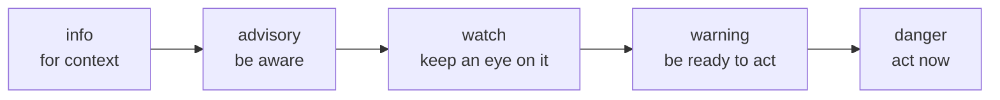
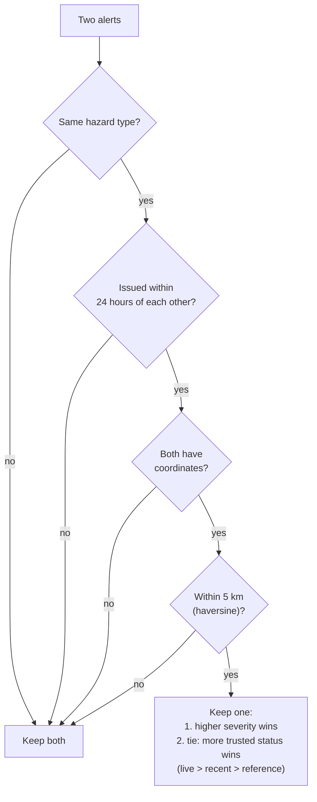
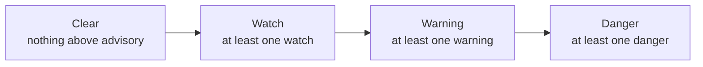
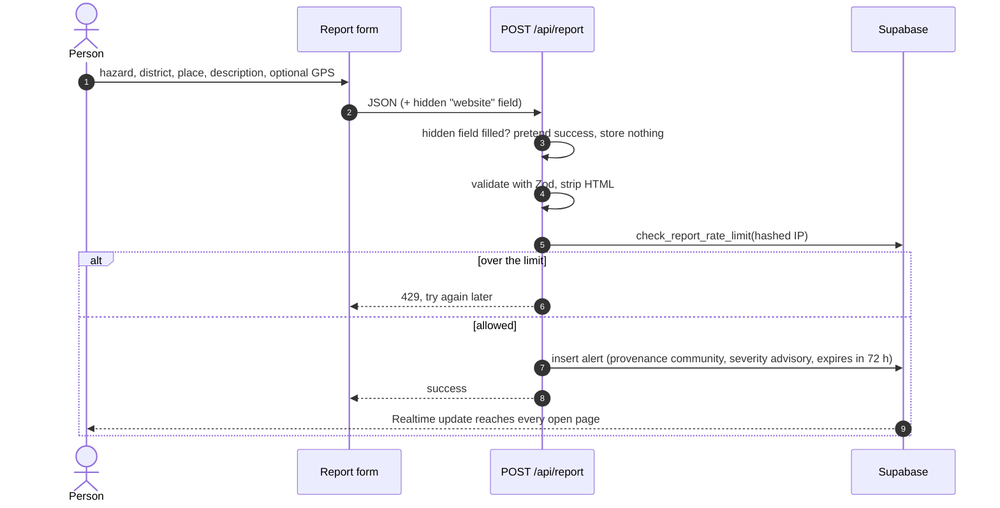

# Core concepts

A handful of ideas shape every part of Satarka. Most of them come from one principle: **in a disaster, a wrong "all clear" is worse than an honest "we don't know".**

## Severity

Every alert has one of five severity levels, ordered from least to most serious:

| Level | Typical source of it | What the UI tells people |
|---|---|---|
| `info` | A gauge below warning level; a small earthquake | Background only |
| `advisory` | GDACS green; an incident without casualties; M3 earthquake | Stay informed |
| `watch` | M4 earthquake; an incident with casualties | Conditions could worsen |
| `warning` | River above warning level; heavy rain; GDACS orange; one-way road | Be ready to move |
| `danger` | River above danger level; DHM red alert; M6+ earthquake; GDACS red; blocked road | Follow authorities now |

**Severity is never shown by colour alone.** Every badge pairs the colour with an icon and a word, so it works for colour-blind readers, on cheap screens and in direct sunlight.

## Honesty labels

Three separate labels describe *how much to trust* an alert. They are kept apart on purpose so the UI can never blur them.

### Source status: how current is this feed?

| Status | Meaning | Example |
|---|---|---|
| `live` | A real feed, checked continuously | DHM river gauges, USGS earthquakes |
| `recent` | Real, but arrives hours or days late | BIPAD incident reports |
| `reference` | A fixed dataset, not monitoring | Glacial lake inventory |
| `report-only` | Situation reports; we link to them, never treat them as alerts | ReliefWeb |
| `no-feed` | No reliable feed exists; we say so and point to the official source | — |

### Timeframe: is it happening now?

| Timeframe | Meaning |
|---|---|
| `now` | Observed recently (inside the source's "acute" window) |
| `forecast` | A model's prediction |
| `report` | After the fact: an older reading or a lagging incident report |

### Provenance: who says so?

| Provenance | Meaning |
|---|---|
| `official` | From a government or international agency feed |
| `community` | Submitted by a person through the report form. Always marked unverified, starts at `advisory`, and expires after 72 hours |

## Deduplication

The same real-world event often arrives through several feeds: a flooding river can show up as a DHM warning, a river gauge reading and a BIPAD incident. `deduplicateAlerts()` in `src/lib/deduplication.ts` keeps one.

Two alerts are treated as the same event when **all** of these hold:

Exact duplicate ids are removed first. Alerts without coordinates are never merged, because there's no way to know they describe the same place.

After deduplication, `sortAlerts()` orders the list by **severity first, then newest first**.

## The national level

The home page answers one question first: how serious is it in Nepal right now? `nationalLevel()` in `src/lib/national-level.ts` reduces the whole alert list to one step of a four-step ladder. The most severe active alert decides it:

The same level drives three things:

| Where | What it shows |
|---|---|
| Home page | The verdict as the headline ("1 alert to keep an eye on"), the ladder with the current step filled, and when the data was checked |
| Every other page | A solid orange or red band under the header, but only at Warning or Danger |
| Phone navigation | A count badge on the Alerts tab, coloured by level |

## Freshness

Data has an age, and the app always reports it truthfully.

- **`issuedAt`** on an alert is when the event happened.
- **`source.fetchedAt`** is when we last checked that feed.
- **`generatedAt`** on a response is when the whole snapshot was produced. On the database path that is the last ingest run (the newest `source_health.last_checked_at`), never the request time.

Reads refuse a database snapshot older than `DB_SNAPSHOT_MAX_AGE_MINUTES` (default 15) and fetch live instead, so a stopped ingest job can't leave old alerts on screen as if they were current.

In the browser, if the network is down, the last response saved in `localStorage` is shown with a banner saying when it's from.

## Failure is reported, not hidden

| Situation | What people see |
|---|---|
| One source fails | Its row in "Source health" says it's unreachable; other sources still show |
| A map layer can't load | The map says that layer is showing last-known data |
| The roads feed is down | "Road status is unavailable right now", never "no blocked roads" |
| The browser is offline | Last-known alerts with their time |
| An upstream host times out | Skipped for 60 seconds, so pages answer quickly instead of waiting again |

## Community reports

People can report what they see. Because these aren't verified, they are handled carefully:

- The district is matched against the 77 official districts, in English or Nepali, and stored in its canonical form.
- Reports appear on the report page and are merged into the main alert list, labelled as community reports.
- An admin can delete a report with `DELETE /api/report?id=…` and the `ADMIN_SECRET`.

## Two languages, one voice

Every page exists in English (`/en/...`) and Nepali (`/ne/...`). The locale is always in the URL, so a shared link opens in the language it was shared in.

- English is the complete catalogue. Nepali overrides it key by key; anything not yet translated falls back to English rather than to machine translation, because safety text must be reviewed by a native speaker.
- Numbers on Nepali pages use Devanagari digits (०–९). Counts are converted by `localizeDigits()` rather than ICU's `#`, because Node and browsers disagree on Nepali digits and the page would otherwise change on load.
- Both scripts are set in one typeface, Mukta, which was designed for Devanagari and Latin together.
- Relative times ("5 minutes ago", "५ मिनेट पहिले") are written by hand rather than with the browser's `Intl` API, because some browsers don't ship Nepali data and silently fall back to English.

## Built for difficult conditions

| Condition | Response |
|---|---|
| Slow or metered mobile data | A low-data mode slows polling to every 10 minutes and turns off live updates and animations |
| Older readers or small screens | Text size setting (normal, large, extra large); every button at least 44 px tall |
| Night or power cuts | Dark theme with a night-blue background, chosen automatically or by the person |
| No signal | Service worker opens the app and recently visited pages; alerts come from the last-known snapshot |
| Emergency | Phone numbers are one tap away on every page: the Emergency button in the header and the strip at the top of the footer |
