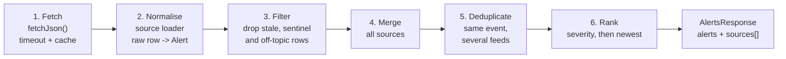
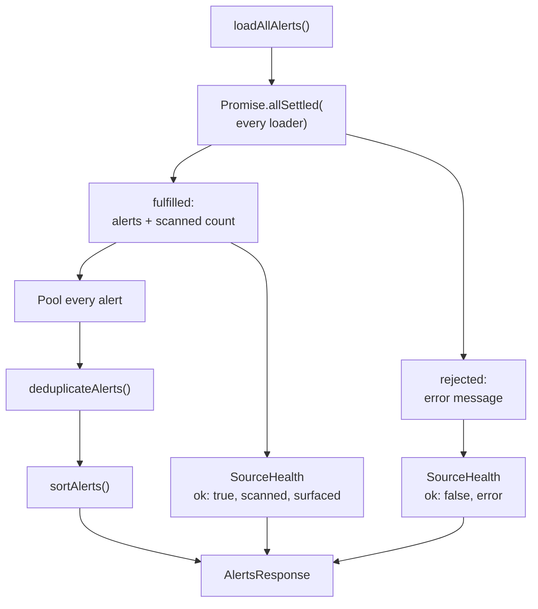
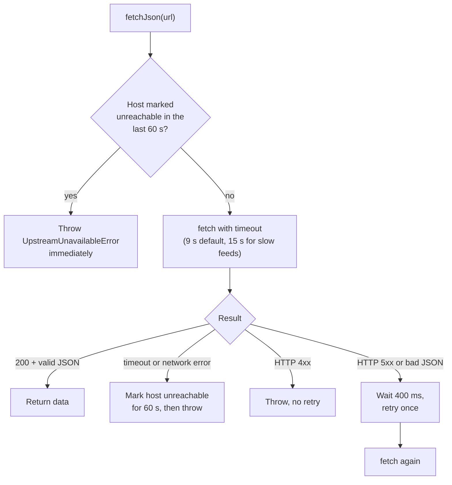

# Data ingestion

Every upstream feed has its own format, update rhythm and quirks. Ingestion is the process of turning all of them into one list of `Alert` objects (see [Data model](data-model.md#the-alert)) that the rest of the app can trust.

## The sources

| Source id | Feed | What we take from it | Status label | Cache window |
|---|---|---|---|---|
| `bipad-alert` | BIPAD `/alert/` | Official DHM flood and weather warnings | `live` | 90 s |
| `bipad-river` | BIPAD `/river-stations/` (fallback `/river/`) | River gauges at or above their warning level, with trend | `live` | 5 min |
| `bipad-rain` | BIPAD `/rain-stations/` (fallback `/rain/`) | Rain gauges over their warning threshold | `live` | 10 min |
| `dor-highway` | BIPAD `/highway/` | Department of Roads closures and one-way sections | `live` | 3 min |
| `bipad-incident` | BIPAD `/incident/` | Recent flood, landslide and similar incidents | `recent` | 15 min |
| `usgs-eq` | USGS earthquake API, Nepal bounding box | Earthquakes from the last 7 days | `live` | 2 min |
| `gdacs` | GDACS event list | International flood alerts for Nepal | `live` | 10 min |
| `geoglows-forecast` | GEOGloWS v2 | 15-day streamflow forecast | `live` | 3 h / 24 h | 

Not part of the alert stream, on purpose:

| Feed | Used for | Why it's separate |
|---|---|---|
| ReliefWeb (UN OCHA) | "Latest situation reports" list, `/api/situation-reports` | A report is background, not a warning |
| Static datasets in `src/lib/map-data/` | River basins, glacial lakes, seismic zones on the map | Reference data, not live monitoring |
| Open-Meteo | `/api/weather` (district weather and air quality) | Available as an API; not used by the current pages |

GEOGloWS is written but only registered when `GEOGLOWS_REACHES` has entries. That list is empty until river reaches are chosen by hand, because an empty forecast feed would look like "no flood risk".

Earthquakes come from USGS rather than BIPAD because BIPAD's earthquake feed lags by about a year.

## The pipeline

Every source follows the same steps. Only step 2 differs from one source to the next.



### 1. Fetch

All upstream calls go through `fetchJson()` in `src/lib/sources/util.ts`. See [Fetching safely](#fetching-safely).

### 2. Normalise

Each loader maps its feed's fields onto `Alert`:

- **Hazard type.** Free text is classified by `classifyHazard()` in `src/lib/classification.ts`, which matches English and Nepali keywords. Anything that isn't a flood, glacial lake flood, earthquake or landslide (fires, road accidents, epidemics) is dropped.
- **Severity.** Each kind of reading has its own rule:

| Reading | Rule | Where |
|---|---|---|
| River level | At or above danger level is `danger`; at or above warning is `warning`. Below warning is not shown | `riverLevelToSeverity()` |
| River / rain status text | "Danger" is `danger`; "above warning" is `warning`; "below" is `info` | `statusStringToSeverity()` |
| Rainfall | A warning or danger interval in the station's averages raises severity to match | `bipad.ts` |
| Earthquake magnitude | M6+ `danger`, M5+ `warning`, M4+ `watch`, M3+ `advisory`, else `info` | `magnitudeToSeverity()` |
| GDACS alert level | Red `danger`, Orange `warning`, Green `advisory` | `gdacs.ts` |
| DHM warning text | Mentions danger or red alert: `danger`; otherwise `warning` | `bipad.ts` |
| Incident | Deaths reported: `watch`; otherwise `advisory` | `bipad.ts` |
| Road | Blocked: `danger`; one-way: `warning` | `highway.ts` |

- **Timeframe.** Readings within the "acute" window are `now`; older ones in the allowed window become `report`:

| Kind | Acute (`now`) | Kept up to |
|---|---|---|
| River and rain gauges | 12 h | 36 h |
| Earthquakes | 24 h | 7 days |
| Road closures | 48 h | 14 days |

- **Location.** Coordinates come from GeoJSON `point.coordinates` (`[lng, lat]`) or flat `latitude`/`longitude` fields, via `extractLatLng()`.
- **Source reference.** Every alert carries `source: { id, name, url, status, fetchedAt }`, so the UI can always link back to the original.

All thresholds live in `CONFIG.thresholds` in `src/lib/config.ts`.

### 3. Filter

Government telemetry is noisy. Loaders drop:

- **Sentinel values.** `-9999`, `-99991`, `-999`, `-99` and an overflowing int64 all mean "no data", not a real reading. `num()` turns them into `null`.
- **Impossible readings.** River levels above 80 m and 24-hour rainfall above 1,000 mm.
- **Stale readings.** Anything older than the "kept up to" window above.
- **Points outside Nepal.** USGS is queried with Nepal's bounding box (26–31°N, 80–89°E).

### 4–6. Merge, deduplicate, rank

`loadAllAlerts()` in `src/lib/sources/index.ts` runs every registered loader at the same time and records each source's health:



Deduplication and ranking are explained in [Core concepts](concepts.md#deduplication).

## Fetching safely

`fetchJson(url, { revalidate, timeoutMs })` wraps `fetch` with the protections every source needs:



- **Timeout.** An `AbortController` stops each request after `CONFIG.timeouts.defaultMs` (9 s).
- **Retry.** One retry for server errors, which are often momentary. No retry for 4xx (it would fail again) or timeouts (it would double the wait).
- **Cooldown.** After a timeout, the host is skipped for 60 seconds, so when BIPAD is down every page doesn't wait out the same 9-second timeout. This cut `/api/map-data` from about 37 s to under 1 s during an outage.
- **Caching.** `next: { revalidate }` stores each response in Next.js's data cache for the source's window.
- **Identification.** Every request sends `User-Agent: Satarka/0.1 (+Nepal disaster awareness; non-commercial)`.

## Writing to the database

`/api/ingest` turns the merged result into database rows. See the ingest sequence in [Architecture](architecture.md#ingest-path) and the tables in [Data model](data-model.md#database-tables).

What the sync does, in order:

1. **Upsert alerts** by `id` in chunks of 100. The same alert arriving again updates its row instead of adding a new one.
2. **Deactivate vanished alerts** with one SQL call, `deactivate_stale_alerts(source_ids, active_ids)`. For every source that loaded successfully, any official alert it no longer reports is set to `is_active = false`. Sources that failed are left alone, so an outage never clears real alerts.
3. **Record river readings** in `river_telemetry_history`. A unique index on `(station_id, measured_at)` means the same reading is stored once, however many times it's seen.
4. **Upsert source health**, one row per source.
5. **Upsert road closures** into `highway_blockages`.
6. **Prune** old data with `prune_old_satarka_records()` (see [Data model](data-model.md#how-data-expires)).

## Adding a new source

1. Create `src/lib/sources/<name>.ts` exporting a `SourceDescriptor`:

   ```ts
   export const exampleSource: SourceDescriptor = {
     id: "example",
     name: "Example Agency feed",
     url: "https://example.gov.np/alerts",      // shown to people as the authority
     status: "live",                             // be honest; see Core concepts
     timeframe: "now",
     hazards: ["flood"],
     note: { en: "Why this source is labelled the way it is", ne: "…" },
     load: async (ctx) => {
       const raw = await fetchJson<ExampleResponse>(URL, { revalidate: 300 });
       const alerts = raw.items.map((r) => toAlert(r, ctx.fetchedAt)).filter(Boolean);
       return { alerts, scanned: raw.items.length };
     },
   };
   ```

2. Add it to `SOURCES` in `src/lib/sources/index.ts`.
3. Add the base URL to `CONFIG.apis` with an environment variable override.
4. Write a test next to it (`<name>.test.ts`) using a recorded sample response. Cover sentinel values, stale rows and the severity mapping.
5. If the feed has a new host, add it to `images.remotePatterns` in `next.config.ts` only if you display its images.

Nothing else needs to change: health reporting, deduplication, the database sync and the UI pick it up automatically.
