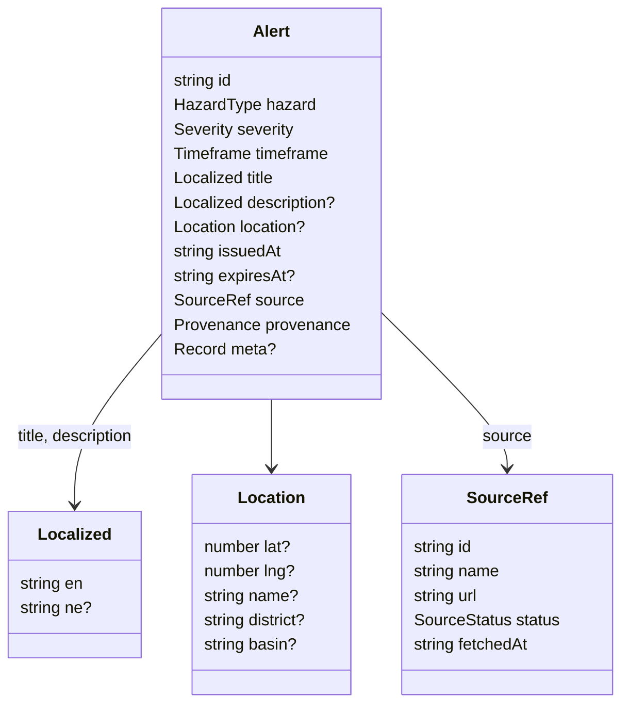
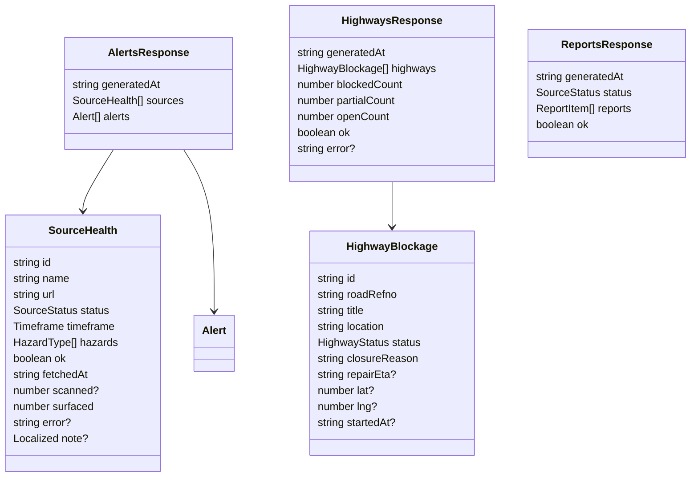
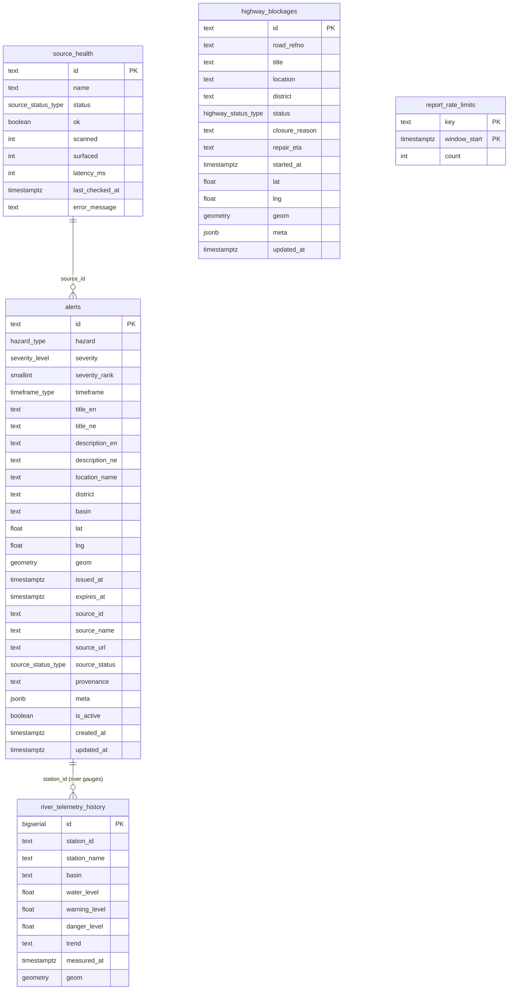
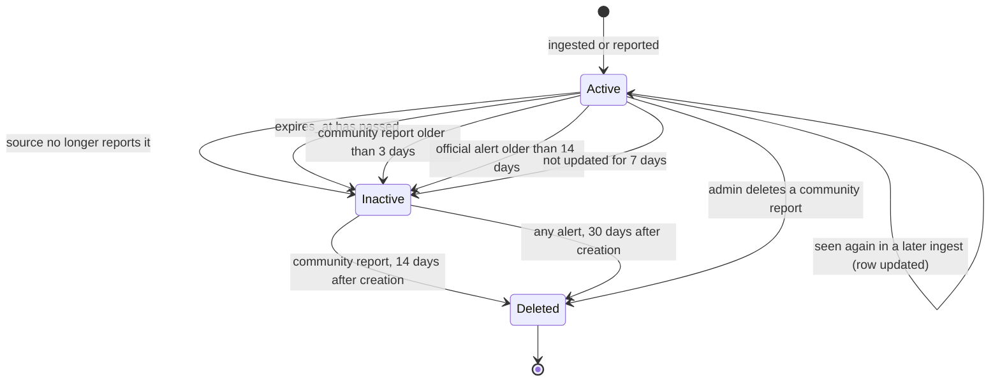

# Data model

There are two layers of data model:

1. **Domain types** in `src/lib/types.ts`. Every source is converted into these, and every page reads them.
2. **Database tables** in `supabase/migrations/`. The ingest job stores domain objects here so pages can read them quickly.

`src/lib/supabase/types.ts` converts between the two (`alertToAlertInsert()`, `alertRowToAlert()` and friends).

## The `Alert`

One hazard item, from any source. Defined as a Zod schema (`AlertSchema`) so it can be validated at runtime.

| Field | Meaning |
|---|---|
| `id` | Stable across fetches, prefixed by source: `bipad-river-123`, `usgs-us6000…`, `com-<time>-<random>` for community reports. Upserts depend on this |
| `hazard` | `flood`, `glof`, `earthquake` or `landslide` |
| `severity` | `info`, `advisory`, `watch`, `warning`, `danger`. See [Core concepts](concepts.md#severity) |
| `timeframe` | `now`, `forecast` or `report` |
| `title`, `description` | English always; Nepali when the source provides it or we generate it |
| `location` | Coordinates are optional: some alerts only name a district or river basin |
| `issuedAt` | When the event or reading happened, not when we fetched it |
| `expiresAt` | Set for community reports (72 hours) |
| `source` | The feed it came from, with its status label and a link to the original |
| `provenance` | `official` or `community` |
| `meta` | Source-specific readings: `waterLevel`, `warningLevel`, `dangerLevel`, `trend`, `magnitude`, `rainfall`, `detailUrl`, `unverified`, … |

### Supporting types

- **`AlertsResponse`** is what `/api/alerts` returns and every alert page renders. `generatedAt` is when the data was produced: the last ingest run on the database path, or the fetch time on the live path.
- **`SourceHealth`** is one entry per source per refresh. `scanned` is how many upstream records were looked at ("200 stations checked"); `surfaced` is how many became alerts. `ok: false` with `error` tells the UI to say the source is unreachable.
- **`HighwayBlockage`** keeps the full Department of Roads record for the highways page. Blocked and one-way closures are also converted into `Alert`s by the `dor-highway` source.
- **`ReportsResponse`** holds ReliefWeb situation reports, kept outside the alert stream.

## Database tables

The relationships are logical, not foreign keys: `alerts.source_id` matches a `source_health.id`, and a river gauge alert's id is its station id in `river_telemetry_history`.

| Table | Written by | Read by | Notes |
|---|---|---|---|
| `alerts` | Ingest (official), `POST /api/report` (community) | `/api/alerts`, pages, `/api/community-reports` | One row per alert id. `is_active` marks what's current. Broadcast over Realtime |
| `source_health` | Ingest | `/api/alerts` | `max(last_checked_at)` is the snapshot's age |
| `river_telemetry_history` | Ingest | `/api/history/[stationId]` (river chart in the alert details) | Unique on `(station_id, measured_at)` |
| `highway_blockages` | Ingest | `/api/highways` | `updated_at` is stamped on every sync and used as the snapshot age |
| `report_rate_limits` | `check_report_rate_limit()` | Same function | Keys are salted SHA-256 hashes of IPs; rows older than a day are deleted |

### Enums

| Type | Values |
|---|---|
| `hazard_type` | `flood`, `glof`, `earthquake`, `landslide` |
| `severity_level` | `danger`, `warning`, `watch`, `advisory`, `info` |
| `timeframe_type` | `now`, `forecast`, `report` |
| `source_status_type` | `live`, `recent`, `reference`, `report-only`, `no-feed` |
| `highway_status_type` | `BLOCKED`, `PARTIAL_OPEN`, `OPEN`, `CLOSED` |

### From `Alert` to a row

`Alert` is nested; the table is flat, so lookups and indexes stay simple.

| `Alert` | `alerts` column(s) |
|---|---|
| `title.en`, `title.ne` | `title_en`, `title_ne` |
| `location.lat`, `location.lng` | `lat`, `lng`, and `geom` as a PostGIS point (`SRID=4326;POINT(lng lat)`) |
| `source.id/name/url/status` | `source_id`, `source_name`, `source_url`, `source_status` |
| `severity` | `severity` and a numeric `severity_rank` (0–4) for sorting |
| (not in `Alert`) | `is_active`, `created_at`, `updated_at` |

### Indexes

| Index | Serves |
|---|---|
| `alerts (is_active, severity_rank DESC, issued_at DESC)` | The main "active alerts, most severe first" query |
| `alerts USING GIST (geom)` | Spatial queries (the `get_alerts_near_point` function) |
| `alerts (hazard, is_active)`, `(district)`, `(basin)` | Filtered lists |
| `river_telemetry_history (station_id, measured_at DESC)` | The river chart |
| `uq_telemetry_station_measured` (unique) | Storing each reading once |
| `highway_blockages (status)`, `GIST (geom)`, `(road_refno)` | Highways page and map |

## Security rules

Row-level security is on for every table.

| Who | Can |
|---|---|
| Anyone (anon key) | Read `alerts`, `highway_blockages`, `river_telemetry_history`, `source_health` |
| Service role (server only) | Everything, including writes and the SQL functions |
| Anyone | Nothing on `report_rate_limits` |

Server code uses two separate clients so this is enforced in practice: `getSupabaseServerClient()` (anon key, for reads) and `getSupabaseAdminClient()` (service role, only for ingest and report writes).

## SQL functions

| Function | Called by | Does |
|---|---|---|
| `deactivate_stale_alerts(source_ids, active_ids)` | Ingest | Sets `is_active = false` on official alerts from the given healthy sources that aren't in the current list. Returns how many |
| `prune_old_satarka_records()` | Ingest | Applies the retention rules below |
| `check_report_rate_limit(key, limit, window_seconds)` | `POST /api/report` | Counts one submission in the current window and returns whether it's allowed |
| `get_alerts_near_point(lat, lng, radius_km, limit)` | Not called by the app today | PostGIS radius search, available for a future "near me" feature |

Only the service role may run the first three.

## How data expires

Other tables:

- **River readings** are deleted after 14 days.
- **Road records** are deleted once a reopened (`OPEN`) road hasn't been updated for 14 days, or once any record hasn't been updated for 30 days.
- **Rate-limit rows** are deleted after a day.

## Migrations

Applied in filename order with the Supabase CLI (`supabase db push`):

| File | Adds |
|---|---|
| `20260913000000_init_satarka_schema.sql` | Extensions, enums, all core tables, indexes, security rules, Realtime publication, first prune function |
| `20260923000000_update_prune_community_reports.sql` | Community report retention |
| `20260930000000_fix_stale_alert_pruning_and_enums.sql` | `CLOSED` road status, stricter retention |
| `20261031000000_dedupe_telemetry_and_bulk_deactivate.sql` | Removes duplicate readings, unique index, `deactivate_stale_alerts()` |
| `20261031000100_community_report_rate_limit.sql` | `report_rate_limits` table, `check_report_rate_limit()` |
