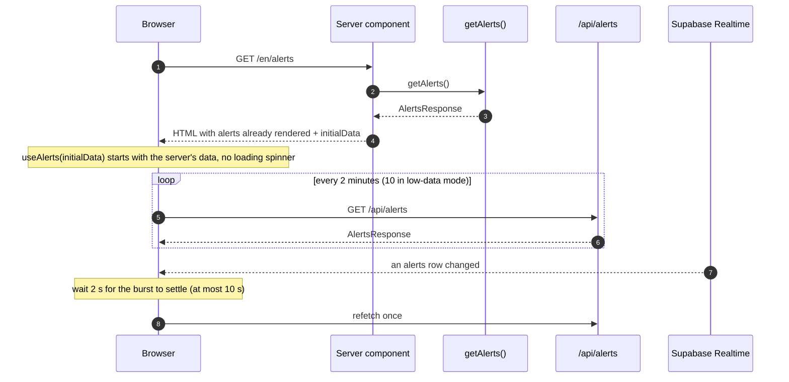
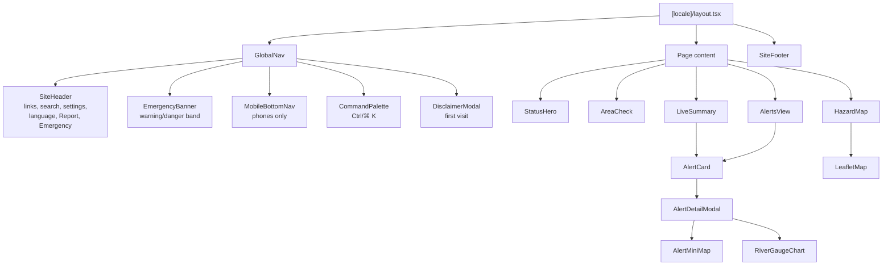
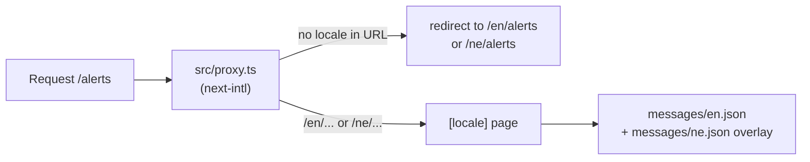

# Frontend

The interface is built with the Next.js App Router, React 19, Tailwind CSS 4 and TanStack Query. Pages render on the server with data already in the HTML, then the browser keeps that data fresh.

## Pages

All pages live under `src/app/[locale]/`, so each exists at `/en/...` and `/ne/...`.

| Path | Shows | Data |
|---|---|---|
| `/` | The national level and verdict, "is it safe where I live?", latest alerts by hazard, preparedness guides, situation reports | Alerts, ReliefWeb reports |
| `/alerts` | Every active alert, with search, hazard and severity filters, sort order, plus source health. `?hazard=` and `?alert=` in the URL preselect a filter or open an alert | Alerts |
| `/alerts/[id]` | One alert on its own page, shareable | One alert (database fallback for older ids) |
| `/map` | Leaflet map: river gauges, earthquakes, road closures, basins, glacial lakes, seismic zones | `/api/map-data` |
| `/highways` | Department of Roads closures, with search and status filters | `/api/highways` |
| `/learn` | The four hazard guides and a record of past disasters | Static content |
| `/learn/[hazard]` | Causes, warning signs, before/during/after steps, emergency numbers, history | Static content |
| `/report` | Community reports and the form to submit one | `/api/community-reports`, `POST /api/report` |
| `/about` | Mission, method, data sources, licences, disclaimer | Static content |

## How a page gets its data

Server components fetch data in parallel and pass it to client components as `initialData`, so the first paint already has content. Client hooks then take over polling.

## Data hooks

Each data source the browser needs has one hook in `src/lib/`. They share the same pattern: TanStack Query for caching and polling, a `localStorage` copy as an offline fallback, and a refetch when the connection comes back.

| Hook | Endpoint | Query key | Polls every | Offline copy |
|---|---|---|---|---|
| `useAlerts` | `/api/alerts` | `["alerts"]` | 2 min (10 in low-data mode) | `satarka-alerts-cache` |
| `useHighways` | `/api/highways` | `["highways"]` | per page setting | `satarka-highways-cache` |
| `useMapData` | `/api/map-data` | `["map-data"]` | per page setting | `satarka-map-data-cache` |
| `useReports` | `/api/situation-reports` | `["reports"]` | 15 min | `satarka-reports-cache` |
| `useCommunityReports` | `/api/community-reports` | `["community-reports"]` | 5 min | — |
| `useUserLocation` | Browser geolocation | — | On request | Not stored on the server |

Each hook returns the data plus `fromCache` and `cachedAt`. When `fromCache` is true, the page shows a banner: "Showing last-known data from …".

Pressing **Refresh** calls the endpoint with `?fresh=1`, which skips every cache and fetches the sources directly. The server ignores repeat presses within 5 seconds.

### Live updates

When Supabase is configured, `useAlerts` subscribes to changes on the `alerts` table. One ingest run changes many rows at once, so change events are collected for 2 seconds (never more than 10) and turn into a single refetch. All components using `useAlerts` share one subscription. Live updates are off in low-data mode.

## Main components

| Component | Job |
|---|---|
| `StatusHero` | Home page headline: the national level verdict, the four-step ladder, and links to alerts and reporting |
| `EmergencyBanner` | Solid band under the header on every page except home and alerts, shown only at Warning or Danger |
| `MobileBottomNav` | Phone tab bar with an alert-count badge; its More sheet leads with "Report a hazard" |
| `AreaCheck` | Pick a district or use GPS; lists alerts within 25 km. The location stays in the browser |
| `AlertCard` | One alert: severity, hazard, title, place, key reading, source and time |
| `AlertDetailModal` | Full alert: plain-language verdict, what to do now, readings, mini map, river chart, links to the source and the full map |
| `CommandPalette` | Search across the 77 districts, emergency numbers, guides and past disasters |
| `HazardMap` / `LeafletMap` | The map, its layer toggles and station search. Loaded only in the browser |
| `ReportFormModal` | The community report form |
| `SiteFooter` | Tap-to-call emergency numbers, links grouped by intent, data credits |
| `SettingsPanel` | Theme, text size and low-data mode |

Heavy pieces (map, modals, command palette) are loaded with `next/dynamic` only when needed.

## Languages and routing

- `src/proxy.ts` (Next 16's name for middleware) adds the locale to any URL without one. It skips `/api`, Next internals and files with an extension.
- `src/i18n/request.ts` loads English, then overlays Nepali on top, key by key.
- Use `Link` and `usePathname` from `src/i18n/navigation.ts`, not from `next/link`, so links keep the current language.

## Settings and accessibility

Settings are stored in `localStorage` and applied by a small script in `<head>` before the first paint, so there's no flash of the wrong theme:

| Setting | Key | Effect |
|---|---|---|
| Theme | `satarka-theme` | `light` or `dark` on `<html data-theme>`; defaults to the system setting |
| Text size | `satarka-textsize` | Normal, large (120%) or extra large (137.5%) |
| Low-data mode | `satarka-lowbw` | Slower polling, no live updates, no animations |

Other rules followed throughout: visible keyboard focus, a "skip to content" link, tap targets of at least 44 px, reduced motion respected, and severity always shown with an icon and a word as well as a colour.

## Offline and installable

- `public/manifest.webmanifest` makes the site installable. `/manifest.json` is served from the same file by a rewrite.
- `public/service-worker.js` is registered in production only:
  - build assets and icons are served from cache first;
  - pages are fetched from the network first, falling back to the last cached copy, then to the home page;
  - `/api/*` is never cached by the worker, so hazard data is only shown offline through the labelled `localStorage` copy.
- Bumping `CACHE_VERSION` in the worker clears every old cache on the next visit.

## Styling

Tailwind CSS 4, with design tokens defined as CSS variables in `src/app/globals.css` for light and dark themes.

Colour has two jobs that never overlap:

| Role | Light | Dark | Used for |
|---|---|---|---|
| Brand (Daura blue, from the border of Nepal's flag) | `#1B4D9C` | `#8AB4FF` | Links, buttons, the current page in navigation. Never for warnings |
| Advisory / clear | `#1F8A4C` | `#2EA862` | Severity, solid fill |
| Watch | `#F5C518` | `#F5C518` | Severity, solid fill (dark text on top) |
| Warning | `#F08A24` | `#F08A24` | Severity, solid fill (dark text on top) |
| Danger | `#C8102E` | `#E0213F` | Severity, solid fill (white text on top) |
| Background | `#F3F5F8` | `#0A1221` | Page ground (cool mist / night blue) |
| Text | `#0E1A2E` | `#EEF2F8` | Body text |

Each severity has three tones: a soft tint for backgrounds (`bg-warning-soft`), a readable text tone (`text-warning`) and a solid fill with its own on-colour (`bg-warning-solid text-warning-on`). Map markers read the solid tones at runtime so they follow the theme.

- **Type:** Mukta, self-hosted with `next/font`, for both Latin and Devanagari. Readings use tabular figures, not a monospace font.
- **Radii follow hierarchy:** panels > cards > controls (`--radius-panel`, `--radius-card`, `--radius-chip`).
- **Shared classes:** `.btn`, `.card`, `.card-link` (a card that is a link), `.shell` (page width and side padding), and the dialog shell `.dialog-backdrop`, `.dialog-panel`, `.dialog-header`, `.dialog-body`, `.dialog-footer`, used by every modal and sheet. On phones dialogs open as bottom sheets with a grab handle.
