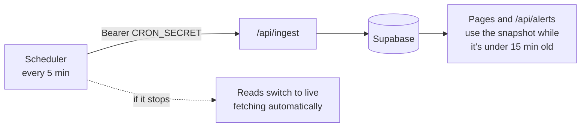

# Operations

How to run, configure and deploy Satarka.

## Running locally

```bash
npm ci
cp .env.example .env.local   # then fill in what you have
npm run dev                  # http://localhost:3000
```

The app works without Supabase: every read falls back to fetching the sources directly, and community reports are disabled. Add the Supabase variables to get the database snapshot, river history charts, community reports and live updates.

| Command | Does |
|---|---|
| `npm run dev` | Development server |
| `npm test` | Unit tests (Vitest) |
| `npm run typecheck` | TypeScript check. Run `npm run build` first; it generates route types the check needs |
| `npm run build` / `npm start` | Production build and server |

## Environment variables

| Variable | Required | Purpose |
|---|---|---|
| `NEXT_PUBLIC_APP_URL` | Production | Public URL, used in sitemap, robots and report links |
| `NEXT_PUBLIC_SUPABASE_URL` | For database features | Supabase project URL |
| `NEXT_PUBLIC_SUPABASE_ANON_KEY` | For database features | Public read key (row-level security applies) |
| `SUPABASE_SERVICE_ROLE_KEY` | For ingest and reports | Server-only write key. Never expose it to the browser |
| `CRON_SECRET` | Production | Protects `/api/ingest`. Without it, ingest refuses to run in production |
| `ADMIN_SECRET` | Production | Protects deleting community reports and listing expired ones |
| `DB_SNAPSHOT_MAX_AGE_MINUTES` | No (15) | Older snapshots are ignored in favour of live fetching |
| `RATE_LIMIT_SALT` | Recommended | Salt for hashing reporter IPs |
| `REPORT_RATE_LIMIT_MAX` | No (5) | Community reports allowed per IP per window |
| `REPORT_RATE_LIMIT_WINDOW_SECONDS` | No (900) | Length of the rate-limit window |
| `BIPAD_API_URL`, `USGS_API_URL`, `GDACS_API_URL`, `GEOGLOWS_API_URL`, `RELIEFWEB_API_URL`, `OPEN_METEO_*_URL` | No | Override upstream endpoints, for example to point at a mock server in tests |
| `RELIEFWEB_APPNAME` | For live ReliefWeb | Approved ReliefWeb app name; without it a fixed list of links is shown |

## Scheduling ingest

Nothing in the repository runs the ingest job; it must be scheduled outside the app. Call it well inside the snapshot window, every 5 minutes is a good default:

```bash
curl -fsS -X POST https://your-domain/api/ingest -H "Authorization: Bearer $CRON_SECRET"
```

Options: Vercel Cron, a GitHub Actions schedule, Supabase `pg_cron` with `pg_net`, or any external cron service.

The response says what happened:

```json
{
  "ok": true,
  "durationMs": 4120,
  "synced": { "alerts": 37, "telemetry": 12, "staleDeactivated": 3, "highways": 41, "sources": 7 },
  "errors": ["Highways load: timed out"],
  "timestamp": "2026-10-31T09:15:02.118Z"
}
```

`ok` is false (HTTP 502) only when both the alert and highway loads fail. Partial failures are listed in `errors` with HTTP 200.



## Database

Migrations are in `supabase/migrations/` and are applied in filename order:

```bash
supabase link --project-ref <your-project-ref>
supabase db push
```

Apply new migrations **before** deploying code that depends on them. The ingest job calls `deactivate_stale_alerts()` and the report endpoint calls `check_report_rate_limit()`, both added by migrations.

See [Data model](data-model.md) for tables, security rules and retention.

## API reference

| Method and path | Auth | Returns |
|---|---|---|
| `GET /api/alerts[?fresh=1]` | — | `AlertsResponse` |
| `GET /api/highways[?fresh=1]` | — | `HighwaysResponse` |
| `GET /api/map-data[?fresh=1]` | — | Map layers (static and live) with per-layer status. Optional `layer` and `format` parameters |
| `GET /api/situation-reports` | — | `ReportsResponse` (ReliefWeb) |
| `GET /api/community-reports` | — | Active community reports. `hazard`, `district`, `limit` filters. `all=true` needs `ADMIN_SECRET` |
| `GET /api/history/[stationId]` | — | River readings for one station from the last 48 hours (up to 200) |
| `GET /api/weather?district=` or `?lat=&lng=` | — | Current weather, forecast and air quality (Open-Meteo) |
| `POST /api/report` | Rate limited | Creates a community report |
| `DELETE /api/report?id=` | `ADMIN_SECRET` | Deletes a community report |
| `GET` or `POST /api/ingest` | `CRON_SECRET` | Runs ingest; see above |

Secrets go in `Authorization: Bearer <secret>`, or `x-cron-secret` / `x-admin-key`. They are never accepted in the URL.

## Continuous integration

`.github/workflows/ci.yml` runs on every pull request and every push to `main`:

1. `npm ci`
2. `npm test`
3. `npm run build`
4. `npm run typecheck`

The build fetches live data while pre-rendering pages. If an upstream feed is down, the build logs a warning and still succeeds.

## Troubleshooting

| Symptom | Likely cause | Check |
|---|---|---|
| `X-Data-Source: upstream-isr` on every `/api/alerts` response | Ingest isn't running, or the snapshot is older than the allowed age | Call `/api/ingest` by hand and read its response |
| Slow first load of the map or highways | An upstream host is timing out (often BIPAD) | Server logs show `roads feed unavailable: timed out`. Later requests are fast for 60 s |
| Ingest returns 401 | Secret sent in the URL, or the wrong secret | Send it as `Authorization: Bearer` |
| Ingest syncs nothing | `SUPABASE_SERVICE_ROLE_KEY` missing | Server logs show `skipping sync` |
| Report spam isn't being limited | Rate-limit migration not applied; the limiter lets reports through when it can't run | Server logs show `rate limit check failed`; run `supabase db push` |
| River chart is empty | No readings stored yet for that station, or Supabase not configured | `river_telemetry_history` rows for the station id |
